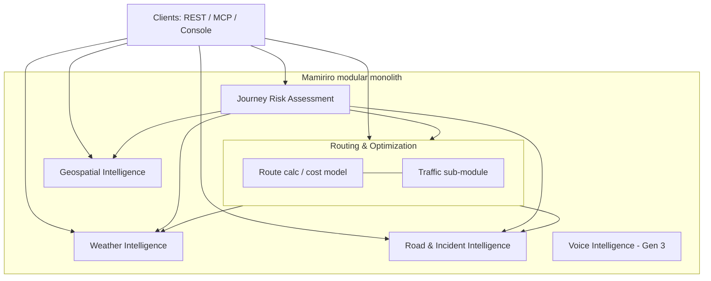
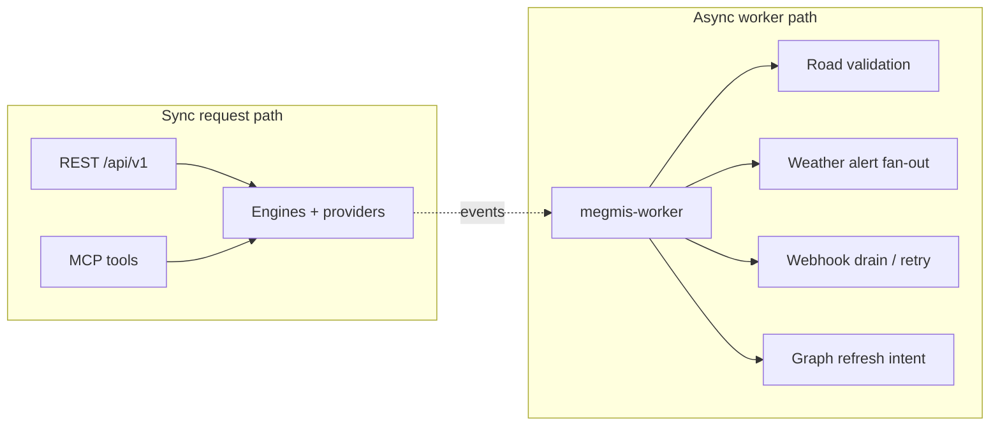
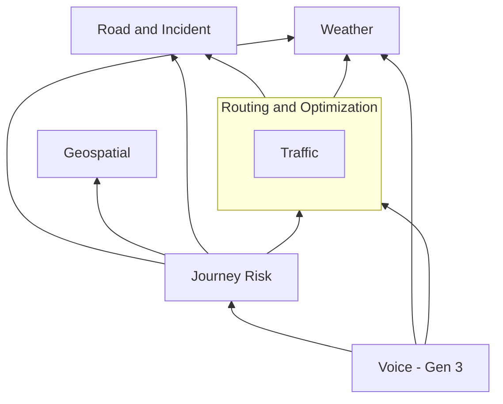

# Mamiriro Service Catalogue (Canonical)

This is the single authoritative service list. Figure 1, Section 4.2 and Figure 2
must be aligned to it (see diagrams below — Traffic nested under Routing).

## Figure 1 — Modular monolith (Gen 1–2)

## Section 4.2 — Sync/async surfaces

## Figure 2 — Dependency graph (Traffic nested)

## Services

| Service | Responsibility | Sync/Async | Interfaces | Owns data |
|---|---|---|---|---|
| Weather Intelligence | current, forecast, hourly, alerts, historical, air quality, agricultural, weather risk | sync + async (alerts) | REST, MCP | weather_cache, weather_snapshots |
| Geospatial Intelligence | geocode, reverse geocode, nearby places, distance/bbox/corridor queries | sync | REST, MCP | places_cache, geocode_cache |
| Routing & Optimization (incl. Traffic sub-module) | route calc, alternatives, reroute, vehicle profiles, traffic-aware costing | sync + async (reroute) | REST, MCP, WebSocket | route_cache, journeys |
| Road & Incident Intelligence | crowdsourced reports, incidents, validation, confidence, expiry | sync + async (validation) | REST, MCP, webhooks | road_reports, incidents |
| Journey Risk Assessment | composes weather+geo+routing+road to score journey risk | sync | REST, MCP | risk_assessments |
| Voice Intelligence | Whisper STT, TTS, agent sessions, Mutare scenario, training lab | async (WebRTC/WS) | REST, WebSocket, WebRTC, Voice Lab `/voice/` | agent_sessions, audio_artefacts, voice_training_utterances |
| Commercial Packs (Gen 4) | Insurance corridor / GovTech emergency & mobility composites | sync | REST, MCP | composed envelopes |
| Ops / Observability (Gen 4) | Provider failover health, GPS calibration, object-store retention, metrics | sync + worker | REST `/ops`, `/metrics` | gps_traces, cost_calibrations, object_artefacts |

## Traffic sub-module (ADR-002)
- Part of Routing & Optimization (not a standalone Gen 2 service).
- Interface: `traffic.get_congestion(corridor[, at_time])`, `traffic.estimate_time(edge, congestion)`,
  `traffic.estimate_time_at(duration, corridor[, at_time])`, `traffic.list_corridors()`.
- REST: `GET /api/v1/traffic/congestion`, `/estimate`, `/corridors`.
- MCP: `get_traffic_congestion`.
- Extraction seam: `megmis.engines.routing.traffic` — can split to its own deployable later without
  changing client contracts.
- Diagrams (Figure 1 / Section 4.2 / Figure 2) above show Traffic nested under Routing & Optimization.

## Tool/endpoint ownership map

| MCP tool | REST endpoint | Owning service |
|---|---|---|
| get_current_weather | GET /api/v1/weather/current | Weather |
| get_forecast | GET /api/v1/weather/forecast | Weather |
| get_hourly_forecast | GET /api/v1/weather/forecast?hourly=true | Weather |
| get_weather_alerts | GET /api/v1/weather/alerts | Weather |
| compare_weather | GET /api/v1/weather/compare | Weather |
| get_historical_weather | GET /api/v1/weather/historical | Weather |
| get_air_quality | GET /api/v1/weather/air-quality | Weather |
| get_agricultural_conditions | GET /api/v1/weather/agricultural | Weather |
| analyze_weather_risk | POST /api/v1/weather/risk | Weather |
| recommend_outdoor_activities | POST /api/v1/weather/activities | Weather |
| geocode / reverse geocode | GET /api/v1/geo/geocode | Geospatial |
| find_nearby_places | GET /api/v1/geo/nearby | Geospatial |
| optimize_route | POST /api/v1/routes/optimize | Routing & Optimization |
| reroute | POST /api/v1/routes/reroute | Routing & Optimization |
| get_route_conditions | GET /api/v1/routes/{id}/conditions | Routing & Optimization (+ Weather + Road) |
| report_road_condition | POST /api/v1/roads/reports | Road & Incident |
| get_road_incidents | GET /api/v1/roads/incidents | Road & Incident |
| get_emergency_facilities | GET /api/v1/geo/emergency | Geospatial |
| assess_journey_risk | POST /api/v1/risk/journey, GET /api/v1/risk/{id} | Journey Risk Assessment |
| get_traffic_congestion | GET /api/v1/traffic/congestion | Routing & Optimization (Traffic) |
| (composite) | POST /api/v1/journeys, GET /api/v1/journeys/{id} | Routing & Optimization (journey state) |
| (composite) | POST /api/v1/agents/sessions | Voice Intelligence |
| list_service_packs / run_service_pack | GET/POST /api/v1/packs… | Commercial Packs |
| (ops) | GET /api/v1/ops/providers, /ops/calibrate, /metrics | Ops / Observability |

## Dependency graph
Weather -> (none)
Geospatial -> (none)
Road & Incident -> (none)
Routing & Optimization -> Road & Incident (costs), Weather (time-of-arrival), Traffic (internal)
Journey Risk -> Weather, Geospatial, Routing, Road & Incident
Voice Intelligence -> MCP clients of all of the above